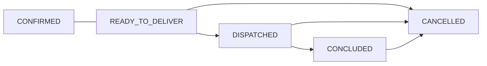

# Eventos de pedido

Requisições Webhook

O Sistema Saipos possibilita a configuração de eventos que serão disparados a medida que determinadas ações forem tomadas dentro do sistema. Quando alterações de status são realizadas em pedidos integrados, é disparado o webhook para a API do parceiro, afim de permitir atualizações e controle dos pedidos.

### Quais são os eventos possíveis?

O Sistema Saipos, permite a configuração de uma URL, a ser executada através de uma chamada POST, para as seguintes ações do sistema:

<br />



Para pedidos do tipo DELIVERY e TAKEOUT, são possíveis eventos:

* Pedido Confirmado: CONFIRMED;
* Pedido Aguardando Entrega: READY\_TO\_DELIVER;
* Pedido Saiu para Entrega: DISPATCHED;
* Pedido Finalizado/Entregue: CONCLUDED;
* Pedido Cancelado: CANCELLED;

Para pedidos do tipo TICKET, são possíveis os eventos:

* Pedido Confirmado: CONFIRMED;
* Pedido Finalizado/Entregue: CONCLUDED;
* Pedido Cancelado: CANCELLED;

Para pedidos do tipo TABLE:

* Como não há alteração de status, pedidos de mesa e comanda não recebem essa requisição.

<Callout icon="🚧" theme="warn">
  Os eventos variam de acordo com o tipo do pedido, conforme descrito em "Eventos por tipo de pedido"
</Callout>

### O que é enviado?

Para todas as requisições que o Sistema Saipos irá realizar para o parceiro via a configuração de webhook, serão enviados o evento, o `cod_store` e o `reference`enviados no json do pedido, conforme:

```json
{
	event: 'CONFIRMED',
	cod_store: '123',
	order_id: '121312131212'
}
```

### Quando acontece?

O pedido é considerado Confirmado, quando o restaurante aceita produzir.

No momento que o pedido é integrado, o restaurante pode optar com Confirmar ou Rejeitar o pedido. Quando o restaurante opta por confirmar, significa que ele aceitou produzir o pedido. Neste cenário, novos eventos do pedido serão enviados ao parceiro, a medida que o restaurante modificar o status do pedido no sistema Saipos.