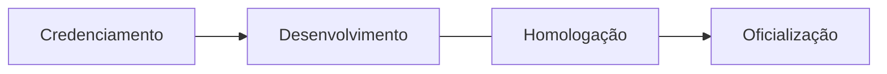

# Introdução

Conheça nossa API de Pedidos

 

Esta API tem como objetivo permitir que parceiros enviem seus pedidos ao Sistema Saipos. Por meio dessa integração, é possível enviar pedidos de **Delivery**, **Retirada**, **Ficha** e **Mesa/Comanda** para que sejam gerenciados dentro do PDV Saipos.

Com essa integração, a loja receberá notificações de novas vendas dos parceiros, poderá visualizá-las no seu kanban, produzir, entregar e gerenciar os pedidos utilizando todas as funcionalidades disponíveis no sistema Saipos.

<Cards columns="3">
  <Card title="Credenciamento de Parceiro" href="https://developer.saipos.com/" icon="fa-key" target="_blank">
    _Clique aqui para se credenciar como parceiro na API de Pedidos._
  </Card>

  <Card title="Homologação" href="https://intercom.help/parceiros-saipos/pt-BR" icon="fa-handshake" target="_blank">
    _Clique aqui para solicitar a homologação da API de Pedidos_
  </Card>

  <Card title="Suporte/Dúvidas" href="https://intercom.help/parceiros-saipos/pt-BR" icon="fa-question" target="_blank">
    _Precisa de ajuda ou está com dificuldades para usar a API de Pedidos? Clique aqui e nos contate_
  </Card>
</Cards>

 

<Callout icon="🎯" theme="default">
  **Uma dica valiosa!**

  Em caso de dúvidas ou problemas técnicos, por favor, envie o JSON e todas as informações ou evidências disponíveis para que possamos agilizar nossa análise.
</Callout>

## Conceitos

Para a Saipos, seu aplicativo será um canal de venda externo, no qual os clientes receberão pedidos que serão integrados e gerenciados dentro de nossa plataforma.

Para facilitar a explicação vamos estabelecer alguns conceitos:

| Conceito                    | Significado                                                                                                                                                                                                                                                                                                            |
| :-------------------------- | :--------------------------------------------------------------------------------------------------------------------------------------------------------------------------------------------------------------------------------------------------------------------------------------------------------------------- |
| Canal de Venda              | É o seu aplicativo/sistema.                                                                                                                                                                                                                                                                                            |
| Loja                        | Quando falamos em loja nos referenciamos a loja que nosso cliente em comum tem dentro do Sistema Saipos.                                                                                                                                                                                                               |
| POS                         | É a loja do nosso cliente em seu aplicativo. Um loja na Saipos pode ter diversos Merchants do seu aplicativo.  Este exemplo é muito comum em restaurantes trabalhem no formato [Dark Kitchen ](https://pt.wikipedia.org/wiki/Restaurante-fantasma)                                                                     |
| Código da Loja (cod\_store) | É o identificador do POS dentro da Saipos. Esse campo é livre e pode ser informado da forma que ficar mais adequada ao seu sistema. A única obrigatoriedade é que este valor seja único por loja.                                                                                                                      |
| Id Partner                  | É o identificado da sua integração com a loja. Cada integração entre sue APP e uma loja na SAIPOS receberá um idPartner diferente. No momento em que solicitar a ativação da sua integração em uma loja, o nosso suporte irá lhe passar o idPartner. Com ele você poderá gerar o token de autenticação para cada loja. |

## Etapas do processo de Integração

### Credenciamento

O primeiro passo é realizar o credenciamento da sua empresa. Para isso, basta preencher o formulário disponível no <Anchor target="_blank" href="https://developer.saipos.com/">Saipos Developer</Anchor>.

Após o preenchimento, o sistema disponibilizará automaticamente as credenciais necessárias para que você possa iniciar o desenvolvimento da integração.

### Desenvolvimento

Com as credenciais em mãos, você poderá iniciar o desenvolvimento da sua solução. Essa etapa é realizada integralmente em nosso ambiente de desenvolvimento (sandbox), utilizando a loja de testes fornecida para simular pedidos e atualizações de status.

Durante o desenvolvimento, é fundamental utilizar nossa documentação técnica para entender o comportamento dos endpoints, as regras de negócio envolvidas e os padrões de resposta esperados.

Consulte nossa documentação de códigos de erro caso ocorram falhas durante o desenvolvimento da sua integração : [códigos de erros](https://saipos-docs-order-api.readme.io/reference/codigos-de-erro)

### Homologação

Após concluir o desenvolvimento e os testes internos, você deve solicitar a homologação da sua integração. Esse pedido é feito pelo caminho indicado no inicio dessa documentação. Após a solicitação, nosso time enviará os critérios para a integração ser homologada, no qual solicitamos evidências que comprovem o funcionamento correto da solução.

**Segue os critérios de homologação**: [Critérios de Homologação](https://saipos-docs-order-api.readme.io/reference/criterios-de-homologacao)

Nosso time técnico fará a análise dessas evidências e, caso identifiquemos algum ponto fora do padrão esperado, entraremos em contato para que os ajustes necessários sejam realizados antes da liberação da próxima etapa.

### Oficialização

Concluído a etapa de homologação com sucesso, sua integração será oficialmente homologada pela Saipos. Nosso time de produto fará alguns combinados do processo de ativação de lojas assim como para possíveis acionamentos de suporte.

A partir desse momento, sua solução poderá ser oferecida ao mercado, e os restaurantes que utilizam nosso sistema poderão ativar a integração diretamente dentro da plataforma. Além disso, você passará a ser reconhecido como um parceiro oficial e poderá ser mencionado em nossos canais de comunicação.

### SLAs de Respostas

* Para **homologação** de API de Pedidos, o retorno será dado em até 5 dia útil, através do email informado na abertura da solicitação
* Para **suporte/dúvidas** solicitadas de API de Pedidos, o retorno será dado em até 5 dias úteis, através do email informado na abertura da solicitação